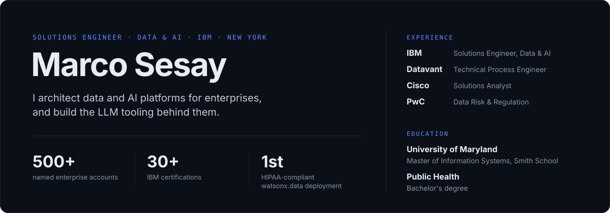
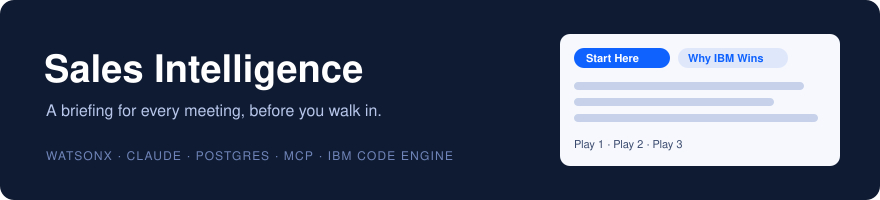
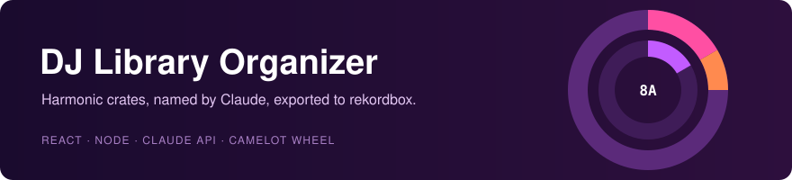
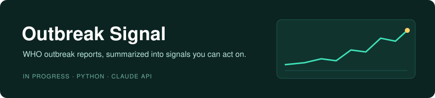

  
  
  

I design data and AI architecture for enterprise clients at IBM across financial services, healthcare and the public sector in New York. My work spans the full lifecycle of an engagement: scoping the data platform, building the proof of concept, and structuring embedded solution agreements where clients run IBM technology inside their own products. Before IBM I worked on healthcare data compliance at Datavant, customer experience analytics at Cisco, and data risk at PwC.

Alongside client work, I develop and maintain AI tooling used in the field. Selected projects are below.

## Featured projects

**[Sales Intelligence](https://github.com/marcosesay/IBM-sales-intelligence).** Generates a seller-ready briefing for any account: an executive summary, a competitive angle, sales plays and a proposed architecture diagram. Research is pulled live, generation runs on watsonx (Llama 3.3 70B) or Claude, and a critic pass checks output against a curated IBM product reference to suppress hallucinated specs. Exposed as an MCP server so agents can query products and past briefings directly. In production on IBM Code Engine with Postgres, covered by a Vitest suite, and used by IBM field sellers.

**[DJ Library Organizer](https://github.com/marcosesay/YOUR-DJ-REPO).** Turns an unstructured local music library into harmonically compatible crates using Camelot key clustering, has Claude name each playlist, and exports to rekordbox XML and .m3u8. Built for my own sets as a working DJ in New York. [Write-up on Substack](https://substack.com/@marcosesay).

**[Outbreak Signal](https://github.com/marcosesay/outbreak-signal-summarizer).** Ingests WHO Disease Outbreak News and uses Claude to extract structured signals: pathogen, location, case counts and severity. Draws on my public health training and healthcare data experience. In active development.

## Additional work

| | |
|---|---|
| **LLM Evaluation Framework** | ONE LINE ON WHAT IT EVALUATES AND HOW |
| **Apollo 11 knowledge base** | Contributor to a RAG system over 400+ mission documents, deployed on Red Hat OpenShift |

## Stack

**Data & AI** · watsonx.ai, watsonx.data, watsonx.governance, DataStage, DataStax, Confluent 
**Security** · IBM Guardium, data governance, HIPAA-compliant architecture 
**AI engineering** · RAG, evals, MCP, agents, Claude API 
**Infrastructure** · IBM Cloud Code Engine, Red Hat OpenShift, Docker, PostgreSQL 
**Languages** · Python, TypeScript, SQL, Java, R

30+ IBM certifications including the watsonx suite · PMI Certified Associate in Project Management
