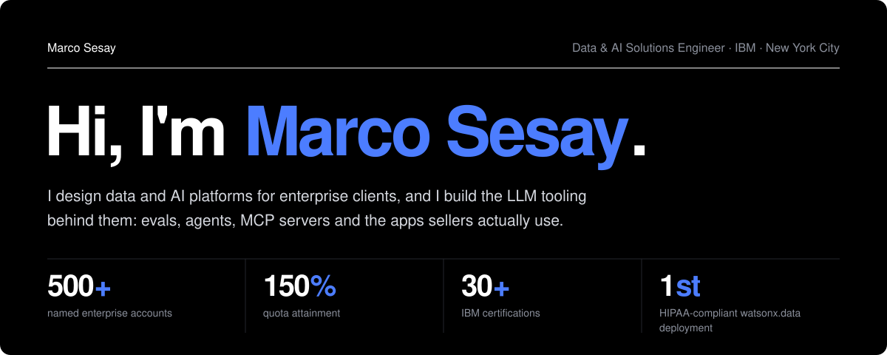
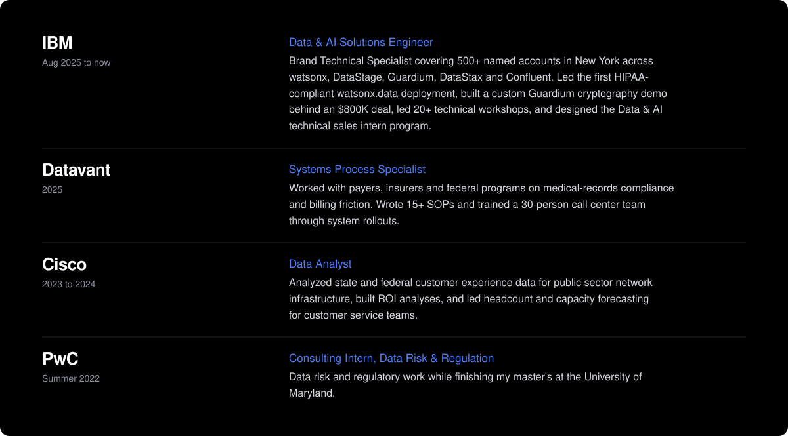
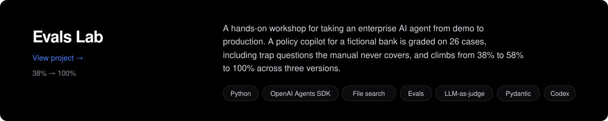
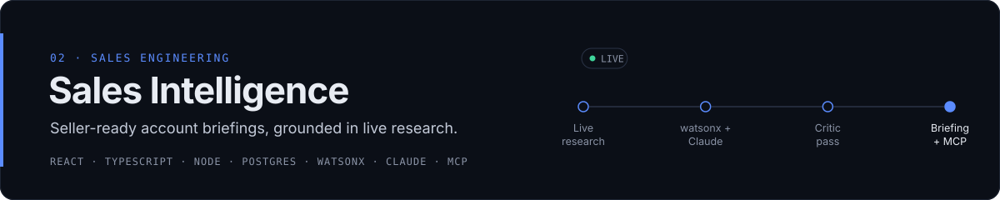
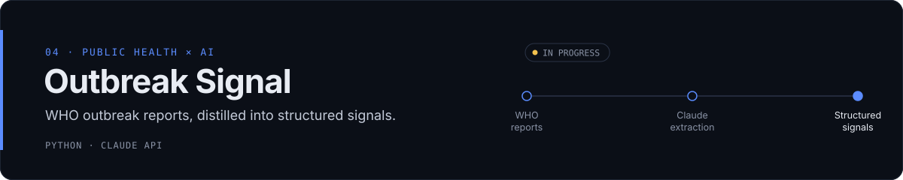
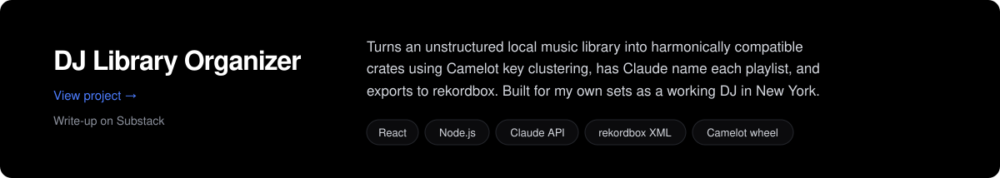
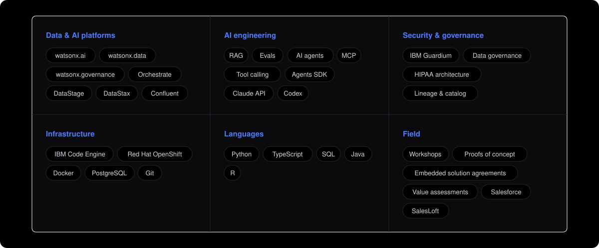
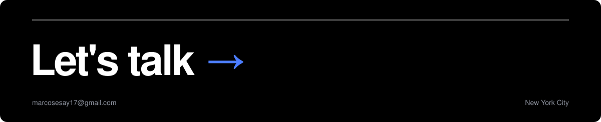

  
  
  
  

## About

I think of myself as a **builder plus seller**. By day I sit with enterprise clients across financial services, healthcare, supply chain and tech, scoping the data platform, building the proof of concept, and structuring embedded solution agreements where companies run IBM technology inside their own products.

Around that work, I ship tools. Some are for the field, like a briefing generator IBM sellers use before calls. Some are for proving a point, like an eval suite that shows exactly why a demo agent isn't ready for production yet.

My path here ran through public health, data risk at PwC, customer experience analytics at Cisco and healthcare data compliance at Datavant, then a master's in Information Systems at Maryland. That mix is why I care so much about grounding: a confident answer that's wrong costs real people something.

Outside work, I DJ in New York, and yes, I built software for that too.

 

## Experience

## Projects

Also: contributor to an Apollo 11 knowledge base, a RAG system over 400+ mission documents deployed on Red Hat OpenShift.

## Skills

30+ IBM certifications including the watsonx suite · PMI Certified Associate in Project Management · M.S. Information Systems, University of Maryland Smith School of Business

